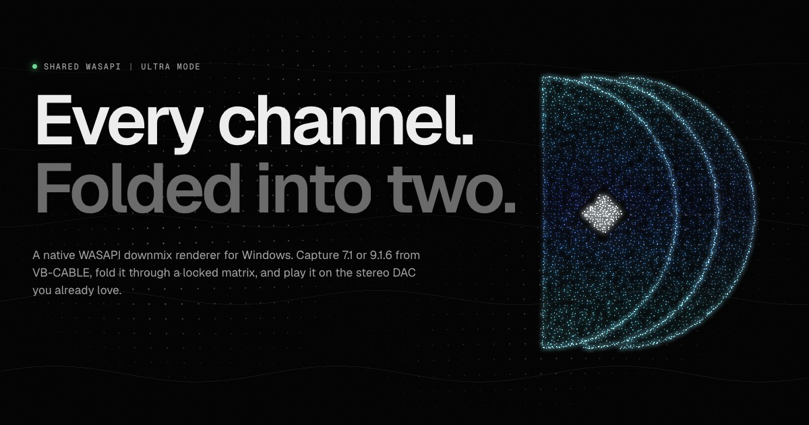
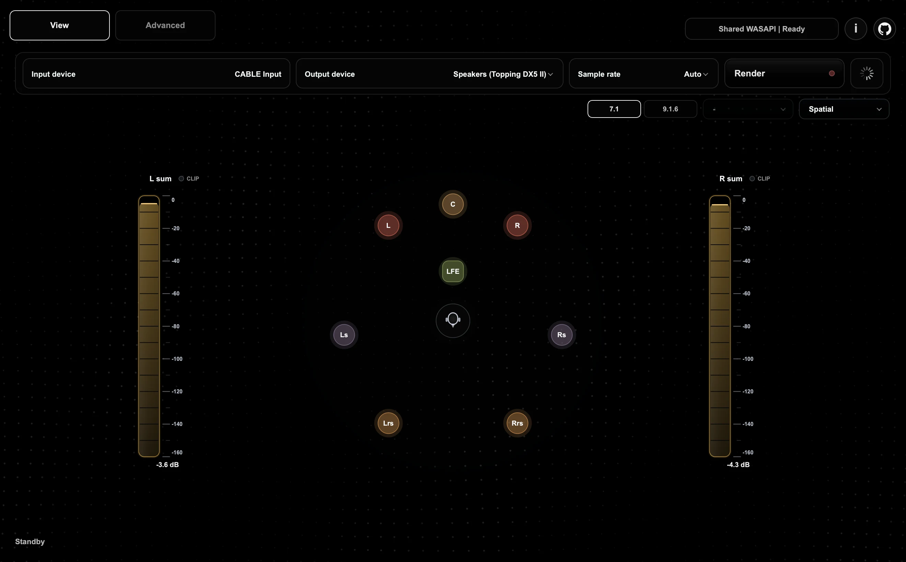

  

  <a href="https://github.com/prospeck/Downmix-renderer-windows/releases/latest/download/Downmix-Renderer-Setup-x64.exe"><b>Download for Windows</b></a>
  &nbsp;·&nbsp;
  <a href="https://prospeck.github.io/Downmix-renderer-windows/">Website</a>
  &nbsp;·&nbsp;
  <a href="https://github.com/prospeck/Downmix-renderer-windows/releases">All releases</a>
  &nbsp;·&nbsp;
  <a href="https://github.com/prospeck/Downmix-renderer-windows/issues">Report a problem</a>

# Downmix Renderer

**Windows 10 and 11, x64.**

Downmix Renderer takes 7.1 or 9.1.6 surround and Dolby Atmos audio from VB-CABLE and folds every channel into stereo for the DAC, speakers or headphones you already own. There is no HRTF processing, so it works equally well on good stereo loudspeakers and on headphones. Parametric EQ, left/right correction and upmixing are built in.

It is inspired by the macOS version built by peqdb: [github.com/peqdb/macos](https://github.com/peqdb/macos).

  

## Install

1. Download **[Downmix-Renderer-Setup-x64.exe](https://github.com/prospeck/Downmix-renderer-windows/releases/latest/download/Downmix-Renderer-Setup-x64.exe)** and run it.
   It installs for your user only, so it doesn't need admin rights. It adds a Start Menu shortcut and can be removed from **Settings → Apps**.
2. If Windows shows **"Windows protected your PC"**, select **More info**, then **Run anyway**. The app isn't code-signed yet. Every release lists a `.sha256` checksum if you want to verify the file first.
3. Install VB-CABLE and set it up as described below. The first time you open Downmix Renderer, a setup guide checks for VB-CABLE and links to everything you need.

Prefer not to use an installer? Download `Downmix-Renderer-Windows-x64.zip` from the [latest release](https://github.com/prospeck/Downmix-renderer-windows/releases/latest), extract the whole `Downmix Renderer Software` folder, and run `Downmixrenderer.exe`. Keep the `_internal` folder next to the EXE.

To upgrade, run the newer installer. Your settings and profiles are kept. The app also tells you when a new version is available.

## Set up VB-CABLE

Install the latest [VB-Audio Virtual Cable](https://vb-audio.com/Cable/). Then open **Control Panel → Sound → Playback** and complete these checks in order.

1.  
   **Right-click CABLE Input → Set as Default Device**

2.  
   **Right-click CABLE Input → Configure Speakers → 7.1 Surround**

3.  
   **Right-click CABLE Input → Properties → Advanced → Default Format → 24 bit, 192000 Hz (Studio Quality)**. 48 kHz is also fine.

4.  
   **Right-click CABLE Input → Properties → Spatial sound → Off**

Optionally, confirm the same setup in **Settings → System → Sound**:

-  
  **Output → CABLE Input → Format: 24 bit, 192000 Hz → Spatial sound: Off**
-  
  **Output → Choose where to play sound → CABLE Input**

## Use it

1. Open Downmix Renderer. Leave **Input device** on CABLE Input.
2. Pick your DAC, speakers or headphones as **Output device**.
3. Set **Sample rate** to **Auto**, or to the rate you chose for CABLE Input.
4. Press **Render** (or Ctrl+R).

Then, if you like:

- **Save a profile** with your route, preamp, EQ, correction and trim, and switch between profiles with one click.
- **Turn on Smart Switching** so the renderer follows when you change the Windows default output.
- **Turn on Auto-start on Boot** to open Downmix Renderer when you sign in and pick up where you left off.
- **Paste a PEQ curve** in Equalizer APO format for a global curve or a per-side correction.

ULTRA Mode is on by default: shared WASAPI with 128-frame periods and Pro Audio scheduling, so other Windows audio keeps working alongside it.

## Troubleshooting

**"No WASAPI input" or the input device is missing.** Set both VB-CABLE drivers, **CABLE Input** and **VB-CABLE 16ch**, to 16 channels, then choose your sample rate. Press F5 in the app to refresh devices.

**No sound after pressing Render.** Check that Windows is playing to CABLE Input (not straight to your DAC) and that your DAC is selected as the output. The status line at the bottom of the window explains what's wrong and what to do next.

**Something else.** Press **F1 → Help and updates → Copy diagnostics**, then [open an issue](https://github.com/prospeck/Downmix-renderer-windows/issues/new) and paste the report. It includes your app version, devices, settings and recent log. Review it before posting, because issues are public.

## Privacy

There is no account, no ads and no telemetry. The only thing the app does online on its own is check this repository for a newer release, at most once a day. You can turn that off in **F1 → Help and updates**.

## License

[GPL-3.0](LICENSE)
