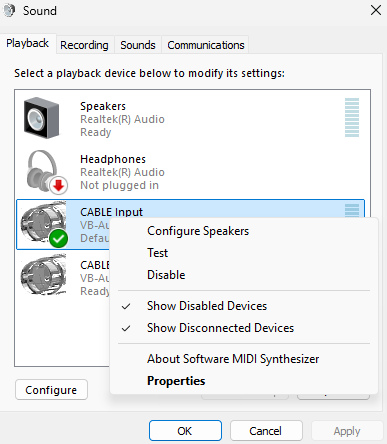
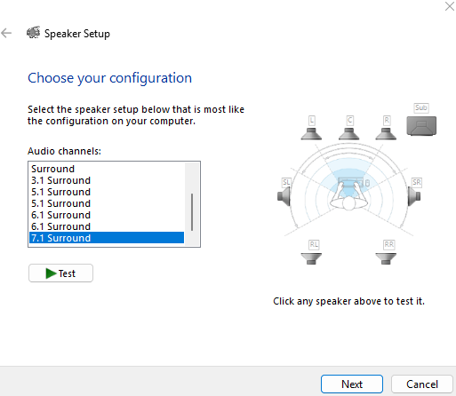
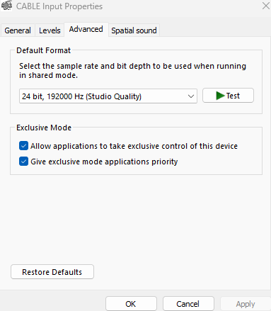
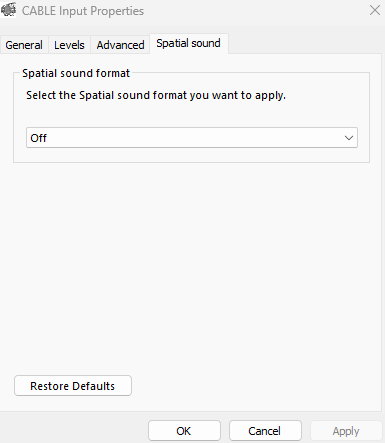
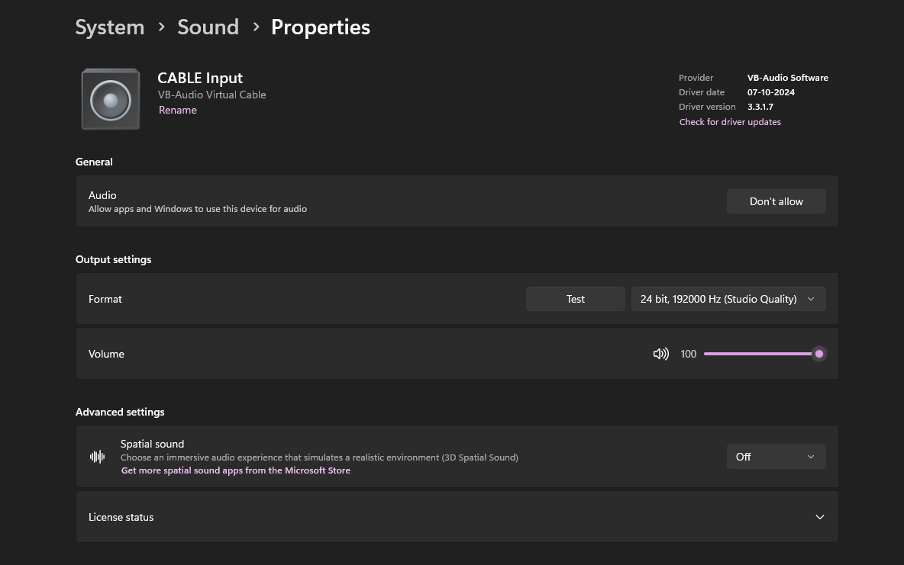
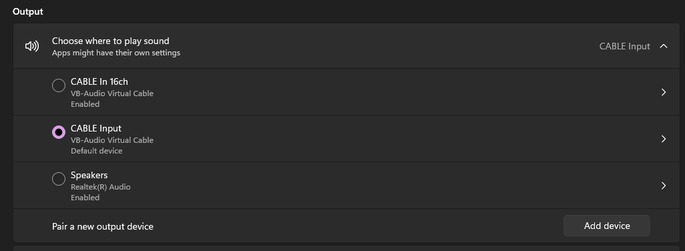

# Downmix Renderer Software

**Windows only.**

Downmix Renderer Software downmixes surround sound and Dolby Atmos content to stereo at resolutions up to a 7.1 speaker configuration. There is no HRTF processing applied, so it works equally well on capable stereo loudspeaker and headphone systems. Parametric equalization, L-R/channel imbalance correction, and upmixing are also available.

This project is mainly inspired by the ideal macOS version built by peqdb: [https://github.com/peqdb/macos.git](https://github.com/peqdb/macos.git)

## Install

1. Download `Downmix Renderer Software.7z` from the Releases section and unzip it.

2. Install the latest VB-Audio Virtual Cable:

   - Main download page: [https://vb-audio.com/Cable/](https://vb-audio.com/Cable/)
   - Direct download: [http://download.vb-audio.com/Download_CABLE/VBCABLE_Driver_Pack45.zip](http://download.vb-audio.com/Download_CABLE/VBCABLE_Driver_Pack45.zip)

3. Open `Control Panel -> Sound -> Playback`, then complete these checks in order.

   1.  
      `Right click CABLE Input -> Set as Default Device`

   2.  
      `Right click CABLE Input -> Configure Speakers -> 7.1 Surround`

   3.  
      `Right click CABLE Input -> Properties -> Advanced -> Default Format -> 24 bit, 192000 Hz (Studio Quality)`

      `48 kHz` is also fine if you prefer that default.

   4.  
      `Right click CABLE Input -> Properties -> Spatial sound -> Off`

4. Optional: verify the same setup in `Settings -> System -> Sound`.

   1.  
      `Output -> CABLE Input -> Format: 24 bit, 192000 Hz (Studio Quality) -> Spatial sound: Off`

   2.  
      `Output -> Choose where to play sound -> CABLE Input`

5. Open `Downmix Renderer.exe`.

6. If Windows shows a warning that it could not verify the app, select `More info` or `More options`, then select `Run anyway`.

7. Inside Downmix Renderer, keep `Input Device` as `CABLE Input` and set `Sample Rate` to `Auto`, or to the same sample rate selected in step 3.

8. Optionally, adjust the preamp value and advanced-menu toggles according to your needs.

NO WASAPI INPUT ISSUE - SET BOTH VB CABLES TO 16CH

1. VB CABLE INPUT
2. VB CABLE 16CH

SET BOTH THE ABOVE DRIVERS TO 16CH AND YOU CAN CHOOSE YOUR DESIRED HZ RATE. 
